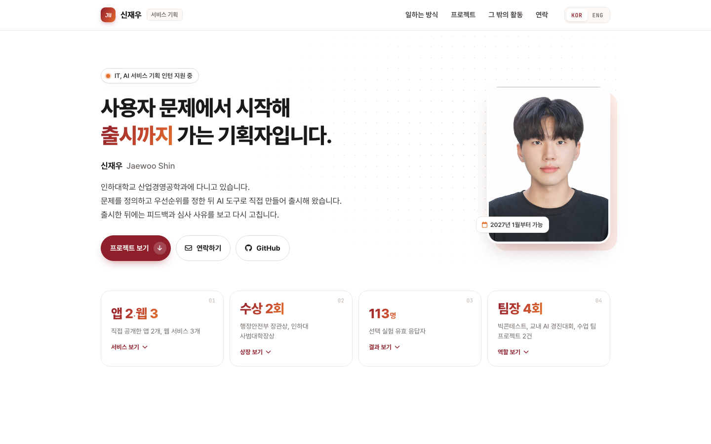

# 신재우 · 서비스 기획 포트폴리오

**사용자 문제에서 시작해 출시까지 가는 기획자**

[**포트폴리오 사이트 바로가기 →**](https://13jvv.github.io/)

 

## 프로젝트

| 프로젝트 | 한 줄 소개 | 역할 | 결과 | 링크 |
|---|---|---|---|---|
| **징검다리** | 플립러닝 수업 전 결손 진단 · 교사 지원 서비스 | 서비스 기획, 프론트엔드 | 2026 INHA AX-EDU HACKATHON 우수상 | [저장소](https://github.com/13JVV/hackathon-app) · [서비스](https://hackathon-app-omega-two.vercel.app/) · [사례](https://13jvv.github.io/projects/jinggeomdari/) |
| **It's me** | 디지털 명함 · 관계 관리 앱 | 기획 · 디자인 · 개발 · 배포 (개인) | App Store · Google Play 출시 | [소개](https://github.com/13JVV/itsme-overview) · [App Store](https://apps.apple.com/kr/app/id6769245736) · [사례](https://13jvv.github.io/projects/itsme/) |
| **CrowdSense** | AI 인파안전 관제 지원 서비스 | 기획 · 설계 · 개발 · 배포 (개인) | 재난안전데이터 활용 창업경진대회 최우수상 (행정안전부 장관상) | [소개](https://github.com/13JVV/crowdsense-overview) · [서비스](https://crowdsense-jvv1.vercel.app) · [사례](https://13jvv.github.io/projects/crowdsense/) |
| **반갑꼬리** | 반려동물 동반여행 출입 조건 판별 앱 | 프론트엔드, 기능 · DB 설계, 배포 | App Store 출시 · 관광데이터 활용 공모전 출품 | [소개](https://github.com/13JVV/bangapkkori-overview) · [App Store](https://apps.apple.com/kr/app/%EB%B0%98%EA%B0%91%EA%BC%AC%EB%A6%AC/id6810158091) · [사례](https://13jvv.github.io/projects/pet/) |
| **사회적 고립 예방 AI 에이전트** | 통신 · 카드 집계 데이터로 고립 위험을 찾고 복지 인력 배분을 제안하는 AI 에이전트 | 팀장 (4인) | 2026 빅콘테스트 AI데이터활용 분야 출품 | [소개](https://github.com/13JVV/capstone-overview) |
| **정책 판정관 J-Verdict** | 정책 효과를 스스로 검증 · 판정하는 인과추론 AI Agent | 기획 · 개발 (개인) | 제주 AI·빅데이터 AI Agent 챌린지 출품 | [저장소](https://github.com/13JVV/jverdict) · [데모](https://jverdict.streamlit.app) · [사례](https://13jvv.github.io/projects/jverdict/) |
| **생성형 AI 구독 모델 분석** | 사용자가 구독에서 무엇을 중요하게 보는지 측정한 선택 실험 | 팀장, 설문 설계 (4인) | 유효 응답 113명, 전문성 중요도 26.4%로 1위 | [사례](https://13jvv.github.io/projects/subscription/) |

프로젝트 페이지마다 **직접 써 보기** 공간이 있습니다. CrowdSense 실시간 관제 화면, It's me 명함 QR 받기, 반갑꼬리 출입 조건 판별, 구독 선택 확률 시뮬레이터, J-Verdict 판정 비교를 사이트 안에서 바로 해 볼 수 있습니다.

## 팀장 경험 (4회)

| 프로젝트 | 팀 | 팀장으로 한 일 |
|---|---|---|
| 빅콘테스트 AI데이터활용 캡스톤 | 4인 | 브랜치 · 리뷰 · 데이터 보호 규칙과 의사결정 로그로 같은 근거를 보게 함, 문제 정의 · 분석 설계 · AI 에이전트 구현 |
| 교내 AI 문제해결 경진대회 | 5인, 4개 전공 | 안전 문제를 "인력과 예산을 어디에 먼저 쓸까"라는 한 질문으로 묶고, 두 화면안을 비교해 팀원 안 채택 |
| 생성형 AI 구독 모델 분석 | 4인 | 설문 초안의 우세 선택지를 발견해 일정을 늦추더라도 재설계, 유효 응답 113명 확보 |
| 강화학습 PPO | 3인 | 10개 설정 × 3개 시드 실험을 맡고, 시드 간 편차까지 보는 기준으로 최종 설정 선택 |

## 일하는 방식

- **MVP로 먼저 내고, 반응을 보고 고칩니다.** 핵심 기능 하나로 출시한 뒤 사용자 피드백과 스토어 심사 의견을 다음 우선순위로 바꿉니다.
- **기능 우선순위는 사용자의 선택으로 정합니다.** 사용자가 무엇을 고르는지 실험으로 확인하고, 팀의 가정이 틀렸다면 데이터를 따릅니다.
- **AI 기능에는 검증과 사람의 확인을 붙입니다.** 출시 전에 정답을 아는 데이터로 시험하고, 틀릴 수 있는 지점에는 사용자가 확인하는 단계를 넣습니다.
- **모르는 것은 모른다고 화면에 보여 줍니다.** 데이터가 없거나 모호하면 "확인 필요", "판정 불가"로 알려 줍니다.

## 사이트 구성

| 경로 | 내용 |
|---|---|
| `index.html` | 메인 페이지 (한국어 · 영어 전환) |
| `projects/` | 프로젝트별 사례 페이지와 직접 써 보기 |
| `assets/base.css` · `assets/case.css` · `assets/site.js` | 메인과 사례 페이지가 함께 쓰는 디자인과 동작 |
| `assets/img/` · `assets/proof/` | 화면 이미지 · 아이콘 · 상장과 자격증 (개인정보 가림) |

정적 HTML · CSS로 만들었고 GitHub Pages로 배포합니다.

 

신재우 · 인하대학교 산업경영공학과 · sjwtlswodn [at] gmail.com

